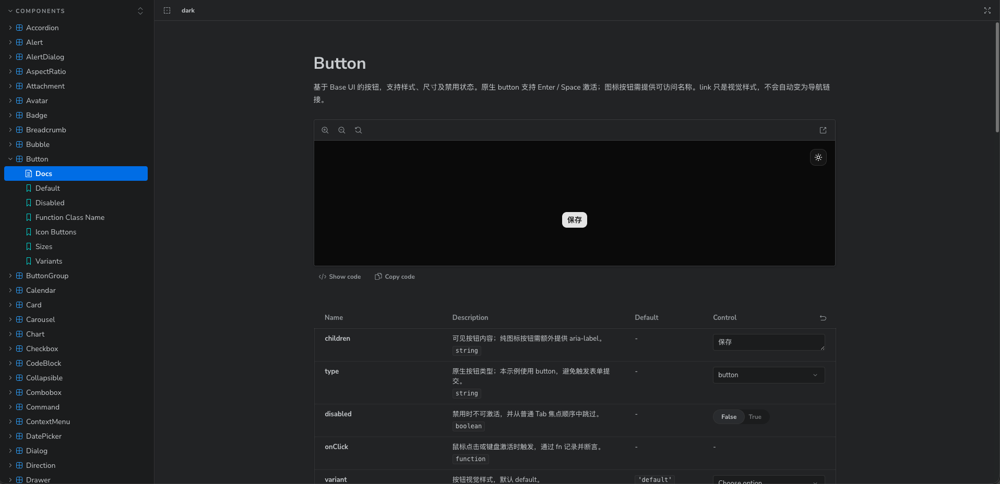
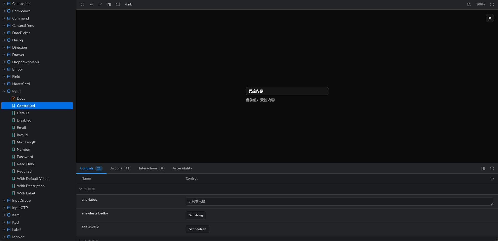

# @badnpm/ui

基于 shadcn/ui 的 React 19 组件库。

## 安装

```sh
npm install @badnpm/ui react@^19 react-dom@^19
```

## 效果预览

### Button 按钮



### Input 输入框



## 使用说明

样式引入、主题配置和完整示例请查看[详细使用文档](./packages/ui/README.md)。
